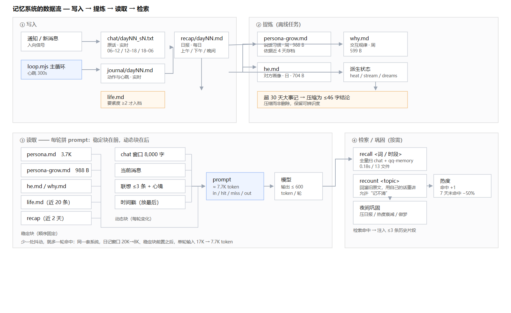

# 设备侧 Agent 的分层记忆实现：一份工程记录

> 对象：一个长期驻留在 Android 设备 Termux 环境中的对话 agent。部署周期 2 个月，数据均为单机实测。

## 0. 系统边界

- **运行环境**：Android 16 / Termux（普通 app uid，无 root）。常驻 Node 进程 `loop.mjs`，心跳 300s，自主动作上限 8 次/天，单轮执行硬上限 150s。
- **交互通道**：系统通知（入向信号）、QQ 聊天页（正文读取）、无障碍服务（动作 / 读屏 / 截图）、`127.0.0.1:8899` 本地 HTTP（设备内调用）。
- **模型**：DeepSeek 系列，单轮上下文目标 ≤ 8K token；输出上限 400~600 token。
- **记忆存储**：`$HOME/her/memory/`，纯文本 + JSON，总 **2.4 MB**；无外部数据库、无嵌入索引、无向量服务。

## 1. 记忆分层：从单块上下文到七层

### 1.1 基线问题

初版仅注入"最近日记"。实测：两天日记原文 **86,162 字符**，注入窗口 6,000 字符，**有效覆盖率 7%**。表现为跨天事实不可达，同一话题在第三天仍需重新澄清。

### 1.2 分层结构（当前实现）

| 层 | 载体 | 更新频率 | 体积 | 注入策略 |
|---|---|---|---|---|
| 人格（稳定） | `persona.md` | 人工 / 周 | 3.7K 字符 | 每轮全量 |
| 行为习惯（衍生） | `persona-grow.md` | 周（从近 4 天存档提炼） | 988 B | 每轮全量 |
| 语义：对方画像 | `he.md` | 日 | 704 B | 每轮全量 |
| 语义：交互规律 | `why.md` | 周 | 599 B | 每轮全量 |
| 大事记 | `life.md` | 触发式追加 | 1,183 B / 38 条 | 最近 20 条 |
| 情景（日报） | `recap/YYYY-MM-DD.md` | 日 | 6 篇 | 近 2 天 |
| 细节（原话） | `chat/YYYY-MM-DD_s{1,2,3}.txt` | 实时 | 13 个时段文件 | 窗口 8,000 字符 |
| 派生状态 | `heat.json` / `stream/` / `dreams/` | 分钟 / 日 | — | 部分注入 |

时段切分固定为 s1 = 06:00–12:00、s2 = 12:00–18:00、s3 = 18:00–次日 06:00，便于按"上午/下午/晚上"检索。

### 1.3 关键取舍

1. **`life.md` 只增不压。** 日报生成时要求模型对每段输出 `要紧度 0-3 / 情绪 / 最要紧一句话`，仅 ≥2 入档。该文件是 `recall` 之外唯一不依赖检索的长期锚点。
2. **超 30 天条目压缩为 ≤46 字符结论**（夜间 job）。压缩而非删除，保留可辨识度。
3. **检索分两级，不可混用。**
   - 主动：`recall <term|时段>` 全量扫描 `chat/*.txt` + `qq-memory.json`，实测 **0.18s / 13 文件**。
   - 被动：每轮 n-gram 命中注入 ≤3 条历史片段，命中项热度 +1。
4. **允许不确定表述。** `recount` 把历史原文回灌，要求以其自身语言复述，允许输出"记不清"；目的是避免逐字回放日志造成的伪精确。
5. **热度衰减**：7 天未命中降权 50%，长期项进入压缩队列。

### 1.4 已知缺陷

- **无向量检索**：同义改写不可达（"难过"检索不到"委屈"）。
- **单向同步**：PC → 设备；设备侧新增记忆不回传。
- **无连续状态**：每次唤醒重新拼装上下文，不保留过程态。
- **文件式存储无锁**：单机单实例可用，多实例并发写会互相覆盖（已用 pid 单实例守护规避）。

### 1.5 数据流



```mermaid
flowchart TD
  subgraph 写入
    N[通知/新消息] --> L[loop.mjs 主循环]
    L --> C[chat/YYYY-MM-DD_sN.txt<br/>原话·实时]
    L --> J[journal/YYYY-MM-DD.md<br/>动作与心跳·实时]
    J --> R[recap/YYYY-MM-DD.md<br/>日报·每日]
    R -->|要紧度≥2| LIFE[life.md<br/>大事记·触发式]
    R -->|超 30 天| COND[压缩为 46 字结论]
    LIFE --> COND
  end
  subgraph 提炼
    C -->|近 4 天| GROW[persona-grow.md<br/>说话习惯·周]
    R --> HE[he.md 对方画像·日]
    C --> HE
    R --> WHY[why.md 交互规律·周]
    C --> WHY
    D[dreams/ · stream/ · heat.json]
  end
  subgraph 读取（每轮拼 prompt）
    P[persona.md 稳定] --> PROMPT[prompt]
    GROW --> PROMPT
    HE --> PROMPT
    WHY --> PROMPT
    LIFE -->|最近 20 条| PROMPT
    R -->|近 2 天| PROMPT
    C -->|窗口 8000 字| PROMPT
    Q[消息 + 联想 ≤3 条 + 心境] --> PROMPT
    PROMPT --> M[模型]
  end
  subgraph 检索（按需）
    M -->|recall 词/时段| C
    M -->|recall| LIFE
  end
```

稳定块（persona → grow → he → why → life → recap）按固定顺序前置，动态块（chat 窗口、消息、心境、联想）后置——这是 §2.2 缓存命中改造的物理依据。

## 2. 上下文预算与前缀稳定性

### 2.1 观测

改造前单轮 prompt 约 **17K token**，其中约 90% 为固定块（人格、行为指南、大事记、日报、摘要）。由于固定块排在动态内容之后（时间戳打头），**缓存前缀每轮失效**，固定块按全价计费。

### 2.2 改造

1. **重排**：稳定块前置，动态块（当前消息、日记窗口、心境、联想）后置。
2. **窗口裁剪**：日记注入 20,000 → 8,000 字符。
3. **计量**：`callModel` 落盘 `tokens in=/hit=/miss=/out=`，逐轮可核。

### 2.3 实测

```
tokens in=7743 hit=2304 miss=5439 out=66
```

- 单轮输入 17K → 7.7K；同会话连续轮次命中率更高。
- 副作用（已接受）：可见历史由 8~11 小时降至 3~4 小时。
- 结论：固定块占比高、轮次密的场景下，**裁剪窗口 + 前缀重排的收益高于更换模型**（本项目三次换模的累计节省低于该单项）。

### 2.4 缓存前缀的三种坏法

按破坏力排序，都是实测踩过的：

1. **时间戳/日期置顶。** prompt 第一行是 `现在是 16:07`，每轮都不同 ⇒ 从第一字节失配，全量 miss。修法：时间戳移到动态块。
2. **字段顺序抖动。** 动态拼接的对象若用 `Object.keys` 遍历、或"最近 N 条"用 `unshift` 后整体拼接，顺序随数据变化 ⇒ 稳定块内部也失配。修法：固定字段白名单 + 固定顺序，缺项填空串而不是跳过。
3. **工具清单变动。** 工具 schema 体积很大（本系统一度 133 个工具 ≈ 3.2 万 token）；任何插件增删都会让整段前缀失效。修法：按 agent 实际需要裁剪工具集（本系统裁到 101 个），并避免"每次运行动态注册"。

补充：切换模型同样会使缓存失效（不同模型、不同计费域），因此"换便宜模型"未必省钱，需与命中率一起算。

### 2.5 计量习惯

固定输出 `in/hit/miss/out` 四项，并在压缩改造、工具裁剪、模型切换三个节点各取一次基线。没有这四项，所谓"优化"无法验证。

## 3. 故障记录（现象 / 根因 / 修复）

### 3.1 消息归属误判

- **现象**：agent 将自身刚发送的消息识别为对方消息，产生"你抄我"类回复。
- **根因**：气泡左右判定依赖"与最近头像的纵向距离"；对方消息行常无头像节点，退化为默认右侧。
- **修复**：增加位置校验（`x1≤200` 判左、`x2≥1050` 判右）；自身发送记录写入 `qq-sent.txt`，读取时按 6 小时窗口去重。

### 3.2 守护脚本输入污染

- **现象**：输出文本中出现 shell 片段，形如 `sh $HOME/her/start-<正文>loop.sh`。
- **根因**：守护脚本通过"切换到 Termux 前台 + `input text`"重启主循环；前台切换失败时按键落入聊天输入框。
- **修复**：守护脚本改为 `run-as com.termux bootstrap-runas.sh` 直接拉起，**全链路不使用 `input text`**；`type_text` 增加前台包校验，命中输入法/终端包直接拒绝。

### 3.3 IME 抢占导致的自我阻塞

- **现象**：发送完成后，后续动作被"用户正在使用设备"判定拦截，表现为"无法打开应用"。
- **根因**：`ACTION_SET_TEXT` 完成后输入法成为前台窗口，命中"忙碌"名单。
- **修复**：`guard_idle` 与 `is_busy_now` 两处放行 IME 与厂商搜索页；前台判定统一改用无障碍 `/fg`，不依赖 adb。

### 3.4 adb 通道不可自愈

- **现象**：adbd 重启或设备重启后 `adb shell` 断开，全部设备操作失效。
- **根因**：TCP 模式由 shell 权限系统服务持有，普通 app uid 无权恢复；`setprop persist.adb.tcp.port 5555` 返回 `rc=1`。
- **修复**：自建无障碍服务承接读屏 / 点击 / 文本输入 / 截图（`127.0.0.1:8899`，`X-Token` 校验）；调度层保留 adb 作为降级路径。

### 3.5 通知栏覆盖

- **现象**：连续两条消息仅处理最后一条。
- **根因**：Android 对同一会话仅保留一条通知，内容为最后一条消息。
- **修复**：通知仅作"有新消息"信号；正文改为读取聊天页末 N 行，按"文本 + 10 分钟"去重。

### 3.6 独立浮层不可见

- **现象**：发布/评论类浮层无法通过 `uiautomator dump` 读取，dump 返回的仍是底层页面节点，偶尔给出陈旧结果。
- **根因**：该类界面是独立 `Window`；`getWindows` 与 `dump` 的窗口选择不一致。
- **修复**：改用截图 + 视觉模型定位可点坐标（离线脚本先跑一遍坐标，再点）；无障碍侧遍历 `getWindows()` 取 `TYPE_APPLICATION` 顶层。

### 3.7 UI 采集的独占与抖动

- **现象**：单次 `uiautomator dump` 耗时 3~6s，且全机独占；并发采集互相踩，出现 `Directory nonexistent` 之类的锁错误；一次动作链常撞上单轮 150s 上限。
- **根因**：`uiautomator` 为单例服务；每次调用都要拉起 Java 层；多个进程 + 多个实例同时抢。
- **修复**：1.2s 结果缓存 + 脏标记（任何 `tap/text/keyevent/swipe` 置脏）；先按前台包做廉价前置判断；采集预算化（单次 25s、进会话总预算 70s）；主循环 pid 单实例守护。

### 3.8 无障碍"假活"

- **现象**：重装无障碍 App 后，进程在、接口 `/ping` 正常，但 `/dump` 返回空，所有采集失败。
- **根因**：无障碍服务绑定未随重装刷新；系统侧仍持有旧连接。
- **修复**：在设置中关闭再开启一次；启动自检增加"`/ping` 通但 `/dump` 空 ⇒ 提示重开开关"。另注：厂商 ROM 拒绝 `settings put secure enabled_accessibility_services`，无法脚本化开启。

### 3.9 分发链路故障（易被误诊为业务故障）

- **现象**：日志出现 `spawn hand.sh EACCES`，上层表现为"打不开聊天/不能回复"。
- **根因**：`cat > new && mv new hand.sh` 会继承临时文件的权限（`600`），丢失执行位。
- **修复**：推送脚本固定 `chmod 700`；另需注意 Windows 侧以文本模式写文件会把 `\n` 转成 `\r\n`，在设备侧 `sh -n` 时报 `word unexpected (expecting "in")`，因此推送后必须在目标机再跑一次语法检查。

### 3.10 开机自启静默失效

- **现象**：设备重启后 agent 不在线，进程一个都没起；日志里连"启动中"都没有，像没执行。
- **根因**（三个叠加，全部踩过）：
  1. 启动器是 VBS 脚本，**含非 ASCII 注释时 `wscript` 解析失败并静默退出**——没有报错、没有窗口；
  2. 用 `netstat` 匹配端口判断"已在跑"，`TIME_WAIT` 残留会被误判为已启动，于是直接跳过；
  3. 启动链经过 `.bat`，尾部 `pause` 与 `start` 的 Ctrl+C 判定会让父进程连带退出，表现为"起了又没了"。
- **修复**：启动器改为纯 ASCII；探活改成打一次 HTTP（任何响应即认为活着）；直接 `spawn` node，不经过 `.bat`；启动前先等联网（每 15s 探测，最多 2 小时，含 DNS 兜底）；全过程写日志，失败位置可定位。

### 3.11 通道 IP 漂移

- **现象**：`ssh` 突报 `Connection refused`，`adb devices` 里设备消失，所有设备操作失败；重启设备与重启网络均不恢复。
- **根因**：DHCP 租约变化导致设备 IP 在 `192.168.0.x` 内跳变；同时 adbd 的 TCP 模式在重启后丢失，PC 侧的 `adb forward` 随之失效。
- **修复**：优先走 USB 序列号（稳定，不依赖网络）；无线时先 `adb connect <当前IP>:5555` 再 `forward tcp:8022`；设备侧加 3 分钟一次的自检（不通就重连并记日志）；最终以自建无障碍 HTTP 通道为主，adb 只作降级路径。

## 4. 适用边界

这套设计的收益与成本都很明确，以下场景不建议采用：

1. **低交互轮次**（< 50 次/天）：日报、提炼、巩固都是模型调用，固定成本会超过收益。
2. **强合规/审计要求**：记忆为自然语言，不可结构化审计；同时必然包含用户对话原文，需额外的脱敏与保留策略。
3. **无长期驻留载体**（无状态函数、按需容器）：没有"持续存在"的前提，分层记忆退化为缓存。
4. **多租户高并发**：文件式存储无锁，需替换存储层并引入并发控制。
5. **亚秒级响应要求**：8K 前缀 + 0.2s 检索对文本对话足够，实时语音链路不够。
6. **高准确性场景**（法律/医疗/账务）：允许"记不清"是设计特性，同时也是风险点，需关闭 `recount` 的不确定性表达。

## 5. 数据导出与脱敏

样本目录与本文一同发布，用于说明记忆文件的真实结构。导出脚本 `tools/sanitize-export.mjs` 的处理原则是**保留结构、抹掉内容**：

| 原始内容 | 替换为 |
|---|---|
| 任意连续中文（≥2 字） | `<cjkN>`（N = 原字数） |
| 5–12 位整数、13 位时间戳 | `<numN>` / `<ts>` |
| IPv4 / URL / 邮箱 / 手机号 | `<IP>` / `<URL>` / `<EMAIL>` / `<PHONE>` |
| API key、长 token | `<KEY>` / `<TOKEN>` |
| 本机路径 | `<PATH>` |

保留：目录与文件名、Markdown/JSON 结构、字段名、日期、字数桶、行数与字节数。

自检机制：导出后重新遍历输出，若仍出现连续中文、≥6 位整数或 IP 段即报错——本次导出 0 处残留。需要三处修正才达到 0：

1. 占位符本身不能用中文（`<中文7字>` 会被自检命中），改 ASCII 形态；
2. 浮点数（如温度 `30.700000762939453`）会伪装成"长数字"，自检前需剔除小数；
3. 体积统计文件（`_manifest.json`）天然含大整数，需排除在自检之外。

**未导出**：`config.json`（密钥与账号标识）、运行态令牌文件、通知原文、截图产物。

注意：掩码后仍可从**字数分布、时间分布、文件名**推断活动强度与作息；公开发布建议再把日期粗化为 `YYYY-MM`。

## 附：可复用与强耦合

| 可直接复用 | 与具体实例强耦合 |
|---|---|
| 分层存储结构、时段切档、`life.md` 打分入档 | 人格卡文本 |
| `recall` / 热度衰减 / 夜间巩固 / 日报-月报 rollup | `he.md`、`why.md` 的提炼 prompt |
| 前缀重排 + 窗口裁剪 + `in/hit/miss/out` 计量 | 具体阈值（窗口大小、热度半衰期） |
| 单实例守护、采集预算化、脏标记缓存 | 与本机 UI 相关的坐标与包名 |
| 脱敏导出脚本与自检规则 | 掩码口径需按业务再调 |

---

**已具备**：§1.5 数据流图（Mermaid，GitHub 可直接渲染）；§3 故障 11 例；§5 脱敏流程与脚本。

**发布前还需**：① 若放 GitHub，示例目录统一改名 `sample/`，真实数据不入库；② 图在非 Mermaid 环境（如公众号）需导出 PNG；③ 建议给 `journal/` 的时间戳做 `YYYY-MM` 粗化。
